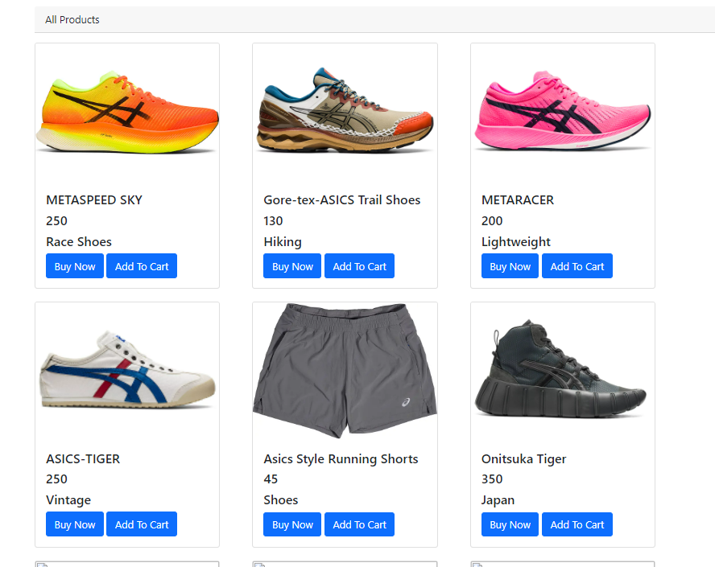

# Fashionably Late Running Shop
- Simple Spring Boot Shopping cart
- Full stack web appliication that lets you add to cart and check out

## Run with Docker (recommended)

You can run the whole app in containers (app + MySQL) so you do not need Java/Maven/MySQL installed locally.

### Prerequisite
- Install Docker Desktop (or Docker Engine + Docker Compose plugin).

### Start everything
```bash
docker compose up --build
```

This starts:
- `casestudy-db` (MySQL 8, database `late`)
- `casestudy-app` (Spring Boot app on port `8080`)

Open the app at:
- http://localhost:8080

### Run in background
```bash
docker compose up -d --build
```

### Stop containers
```bash
docker compose down
```

### Stop containers and remove database data volume
```bash
docker compose down -v
```

### Rebuild app image after code changes
```bash
docker compose build app
docker compose up -d
```

### Helpful logs
```bash
docker compose logs -f app
docker compose logs -f db
```

### Preview



# Spring Initializr used to set up
https://start.spring.io/#!type=maven-project&language=java&platformVersion=2.6.7&packaging=jar&jvmVersion=11&groupId=com.example&artifactId=demo&name=demo&description=Demo%20project%20for%20Spring%20Boot&packageName=com.example.demo&dependencies=web,security,data-jpa,mysql,lombok,devtools


## Tech Used:
- JPA
- JSP,CSS,JS
- MySql,Database Scripts,Queries
- Database - CRUD Operations
- Object-Oriented Programming(Java)
